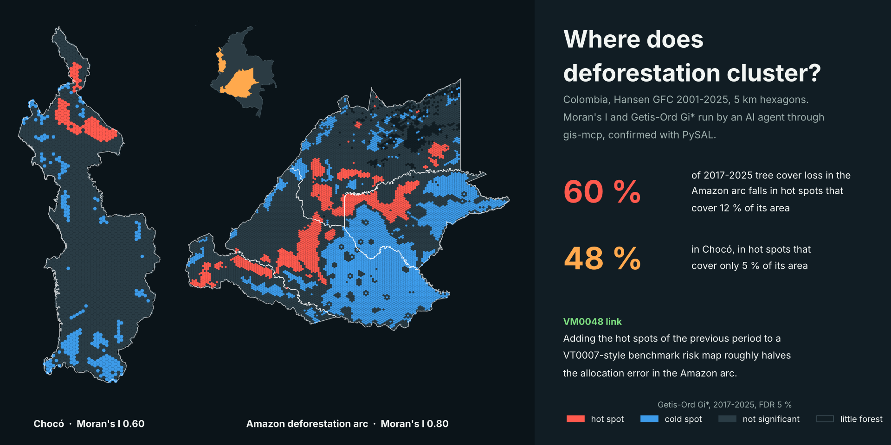
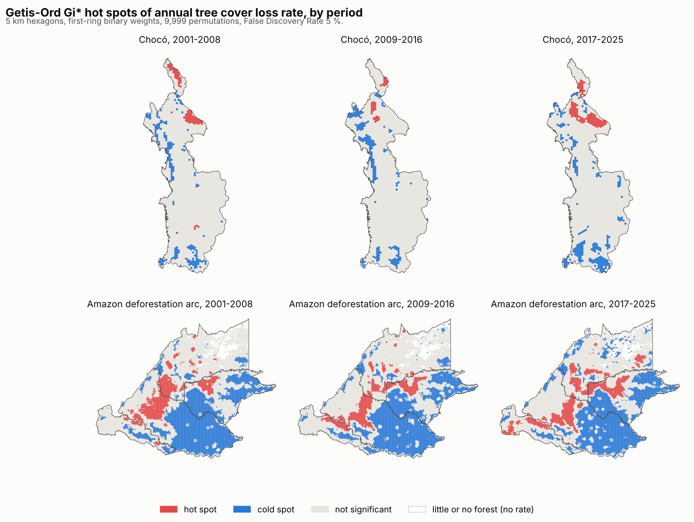
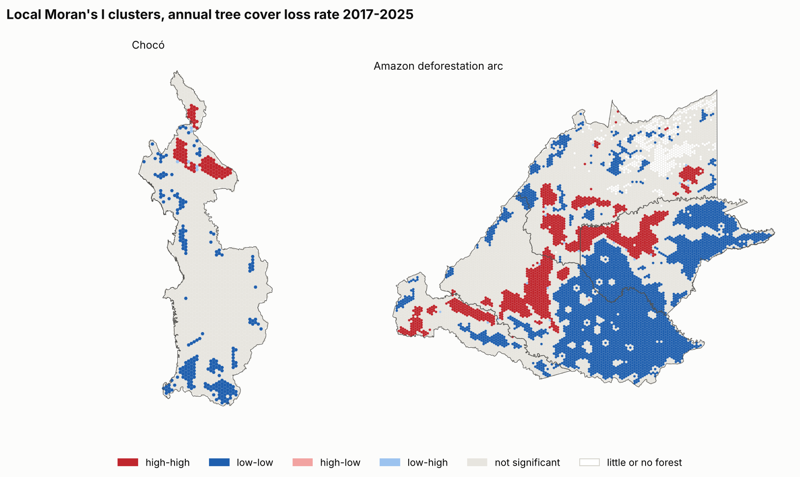
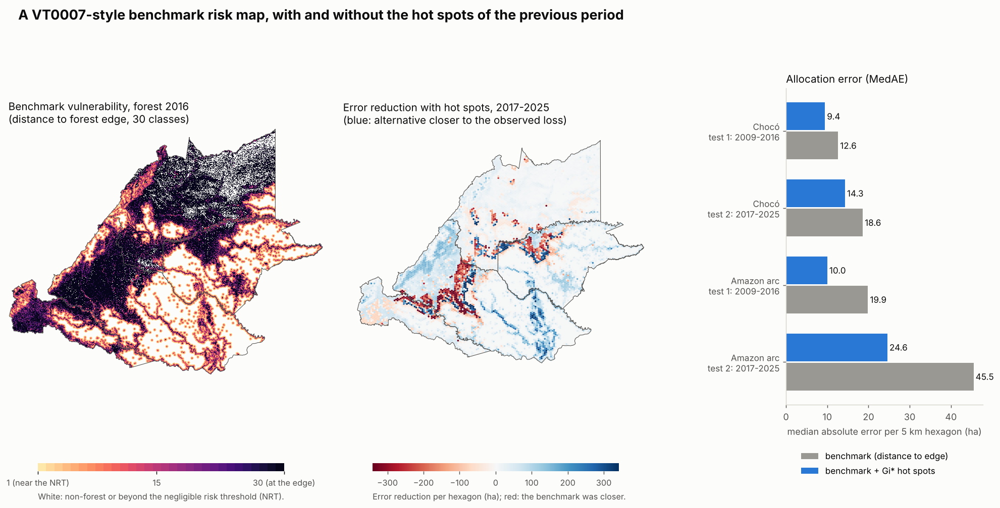

# deforestation-hotspots-colombia



[](https://github.com/albertolozada/deforestation-hotspots-colombia/actions/workflows/tests.yml)
[](https://colab.research.google.com/github/albertolozada/deforestation-hotspots-colombia/blob/main/notebooks/01_analysis.ipynb)
[](LICENSE)

**Deforestation in Colombia is strongly clustered, and the clusters of one period help predict where the next period's deforestation goes. Adding them to a VT0007-style benchmark risk map, as used with Verra's VM0048, roughly halves the allocation error in the Amazon deforestation arc.**

## Question

1. Is tree cover loss spatially clustered in two contrasting Colombian regions, the **Amazon deforestation arc** (Meta, Guaviare, Caquetá and Putumayo) and **Chocó**, and how have the clusters moved between 2001 and 2025?
2. Can an AI agent run this analysis with real GIS tools (the PySAL tools of [gis-mcp](https://github.com/mahdin75/gis-mcp)) and get the same numbers as a script?
3. Do past hot spots add information to the benchmark deforestation risk map of **VCS Tool VT0007** (Unplanned Deforestation Allocation), which VM0048 projects rely on?

## Study areas

| Region | Departments | 5 km hexagons | Forest 2000 (ha) |
|---|---|---|---|
| Amazon deforestation arc | Meta, Guaviare, Caquetá, Putumayo | 11,841 | 19,948,349 |
| Chocó | Chocó | 2,214 | 4,540,103 |

Forest is Hansen `treecover2000` >= 30 %, the canopy threshold of the national forest definition used by IDEAM.

## Data

| Dataset | Source | Licence | Original CRS | Period |
|---|---|---|---|---|
| Global Forest Change v1.13 (`treecover2000`, `lossyear`), tiles 10N_080W, 00N_080W, 10N_070W | Hansen et al. 2013, University of Maryland | CC BY 4.0 | EPSG:4326 | 2000-2025 |
| Department boundaries (ADM1), gbOpen release 9469f09 | geoBoundaries, from OpenStreetMap | ODbL 1.0 | EPSG:4326 | 2017 |

Raw tiles (about 1.6 GB) are not stored here; `scripts/01_download_data.py` downloads them. The processed 5 km hexagons and all results are in [`data/processed`](data/processed) and [`results`](results). See [`data/README.md`](data/README.md).

## Method

1. **Aggregate** Hansen 30 m pixels to 90 m counts (`02_aggregate_gfc.py`): forest 2000 and loss in **2001-2008, 2009-2016 and 2017-2025** (the last period has nine years, so rates are annual).
2. **Hexagons** (`03_build_hexgrid.py`): 5 km hexagons (21.65 km²) built in a Lambert Azimuthal Equal Area projection centred on Colombia. Every 30 m pixel is weighted by its **geodesic area**; nothing is measured in degrees. The variable is the **annual loss rate** (% of the forest at the start of each period). Hexagons with less than 200 ha of forest at the start of a period get no rate.
3. **Agent step** (`04_spatial_stats.py`): the gis-mcp server is launched over stdio, as an AI host would launch it, and its tools `morans_i`, `moran_local` and `getis_ord_g_local` are called through an MCP client, with the equal-area CRS and a 5.5 km distance band (the first ring of hexagons).
4. **Script step**: the same statistics are recomputed with `esda`, and the maps use choices the tool does not expose: **Getis-Ord Gi\*** (the hexagon itself included), binary first-ring weights, **9,999 permutations** and a **False Discovery Rate** correction at 5 %.
5. **VT0007-style test** (`05_vt0007_benchmark.py`): a benchmark risk map from the distance to the forest edge (30 geometric classes up to the negligible risk threshold that contains 99.5 % of past loss), intersected with departments, fitted on one period and applied to the next. The alternative splits the same modelling regions by the Gi\* hot / cold spot class of the fitting period. Both are scaled to the observed loss and scored with the **median absolute error (MedAE)** per hexagon, in two sequential tests.

## Results

### 1. Loss is strongly and persistently clustered

| Region | Period | Hexagons | Moran's I (gis-mcp) | Moran's I (esda) | Hot spots: share of area | Hot spots: share of loss |
|---|---|---|---|---|---|---|
| Amazon arc | 2001-2008 | 11,401 | 0.798 | 0.798 | 10.5 % | 54.5 % |
| Amazon arc | 2009-2016 | 11,395 | 0.791 | 0.791 | 9.5 % | 54.4 % |
| Amazon arc | 2017-2025 | 11,384 | 0.802 | 0.802 | 12.0 % | **60.1 %** |
| Chocó | 2001-2008 | 2,214 | 0.657 | 0.657 | 3.6 % | 38.5 % |
| Chocó | 2009-2016 | 2,214 | 0.609 | 0.609 | 1.6 % | 29.5 % |
| Chocó | 2017-2025 | 2,214 | 0.604 | 0.604 | 5.1 % | **48.1 %** |

All global statistics have pseudo p-values of 0.001, the minimum with 999 permutations. In the Amazon arc, **60 % of the 2017-2025 loss happened in 12 % of the area**. Chocó is less clustered, but its hot spots, concentrated in the north of the department (lower Atrato and the Chocó side of Urabá), have grown since 2016.





### 2. The agent and the script agree

gis-mcp's `morans_i` matched esda to four decimals in all six runs, and its local Moran's I values matched to 1e-14. Reading the tool code and its outputs also showed what an analyst must add:

- `getis_ord_g_local` computes **Gi, not Gi\*** (esda's default `star=False`), with inverse-distance, row-standardised weights and 999 permutations.
- **No correction for multiple testing.** With 11,000 hexagons, about 550 would be "significant" at p < 0.05 by chance.
- The tools default to `target_crs="EPSG:4326"` and convert metres to degrees by dividing by 111,000. We passed an equal-area CRS and a band in metres.
- **Isolated units are silently dropped** from the local results, so the output lists no longer align with the input rows. We excluded the 5-6 isolated hexagons before calling the tools.
- The server prints a start-up line to stdout, the MCP protocol channel. The Python MCP client tolerated it.

The agent explored, the script confirmed, and both agreed.

### 3. Past hot spots improve the VT0007-style allocation

| Region | Test | NRT | Observed loss (ha) | MedAE benchmark (ha) | MedAE with hot spots (ha) | Change |
|---|---|---|---|---|---|---|
| Amazon arc | fit 2001-2008, predict 2009-2016 | 3.6 km | 596,935 | 19.9 | **10.0** | -50 % |
| Amazon arc | fit 2009-2016, predict 2017-2025 | 4.1 km | 1,182,961 | 45.5 | **24.6** | -46 % |
| Chocó | fit 2001-2008, predict 2009-2016 | 6.9 km | 48,770 | 12.6 | **9.4** | -25 % |
| Chocó | fit 2009-2016, predict 2017-2025 | 4.7 km | 56,123 | 18.6 | **14.3** | -23 % |



VT0007 accepts an alternative model only if it beats the benchmark's MedAE in both the calibration and the confirmation test. In this simplified set-up the hot spot alternative does so in both regions. The distance to the edge tells where deforestation *can* happen; the clusters add where it is *already moving*. This makes spatial autocorrelation a reasonable candidate covariate for alternative risk maps, and a useful check for a VVB reviewing allocated activity data.

## Limitations

- **Tree cover loss is not deforestation.** Hansen loss includes natural disturbance, fire and the harvest of plantations, and is not Colombia's official deforestation data (IDEAM, SMByC).
- **This is not the official VT0007.** The test uses 90 m cells, a 50 % rule for forest cells, departments as administrative divisions, quantities scaled to the observed loss ("testing" mode) and MedAE over 5 km hexagons. Risk maps for VM0048 projects are produced by Verra's designated service providers with the official tool ([UDef-ARP](https://github.com/Clark-Labs/UDef-ARP)).
- The alternative has three times more modelling regions; it was tested only out of sample, on the next period, which limits but does not remove the risk of over-fitting.
- Results depend on the **5 km hexagon size** and the 5.5 km band (modifiable areal unit problem).
- **CRS used:** areas, hexagons and distance bands in LAEA Colombia (`+proj=laea +lat_0=4 +lon_0=-73.5`); pixel areas geodesic on WGS84; edge distances on a locally metric 90 m grid.

## Reproduce it

**In your browser:** the Colab notebook loads the processed hexagons, runs gis-mcp through MCP and confirms the results with esda.

**Full pipeline on your computer** (about 2 GB of disk). gis-mcp 0.15 pins old versions of numpy and rasterio, so it is installed in its own environment with [uv](https://docs.astral.sh/uv/) and called as a separate process, the way an AI host calls it:

```bash
git clone https://github.com/albertolozada/deforestation-hotspots-colombia.git
cd deforestation-hotspots-colombia
conda env create -f environment.yml && conda activate defor-hotspots
uv tool install --python 3.12 gis-mcp==0.15.0
python scripts/01_download_data.py                      # Hansen tiles and boundaries
python scripts/02_aggregate_gfc.py --region amazon_arc  # repeat with --region choco
python scripts/03_build_hexgrid.py --region amazon_arc  # repeat with --region choco
python scripts/04_spatial_stats.py --gis-mcp "$(which gis-mcp)"
python scripts/05_vt0007_benchmark.py --region amazon_arc  # repeat with --region choco
python scripts/06_figures.py
```

## Related work

- [carbon-geo-mcp](https://github.com/albertolozada/carbon-geo-mcp): my MCP server with audit-oriented GIS checks for carbon projects.
- [gis-mcp](https://github.com/mahdin75/gis-mcp) by Mahdi Nazari Ashani, and the article *MCP for GIS: From Chatbots to Spatial Agents* by Joe T. Santhanavanich (2026).
- Verra, [VT0007 Unplanned Deforestation Allocation v1.0](https://verra.org/documents/vt0007-unplanned-deforestation-allocation-v1-0) (2024), and VM0048.
- Hansen, M. C. et al. (2013). High-Resolution Global Maps of 21st-Century Forest Cover Change. *Science* 342: 850-853.

## Repository structure

```
├── data/processed/   5 km hexagons with rates, LISA, Gi* and VT0007 predictions (GeoPackage)
├── results/          summary tables and the 2016 benchmark risk class rasters
├── notebooks/        Colab-ready notebook (agent step + script step)
├── scripts/          01 download, 02 aggregate, 03 hexagons, 04 statistics, 05 VT0007 test, 06 figures
├── tests/            unit tests of the geometric and VT0007 helpers
└── outputs/maps/     figures used in this README
```

## Author

**Alberto Lozada Silva**, forestry engineer and carbon project auditor.
Portfolio: [albertolozada.github.io](https://albertolozada.github.io) · [LinkedIn](https://www.linkedin.com/in/alberto-lozada-silva/)

<details>
<summary><b>En español</b></summary>

Análisis de la agrupación espacial de la pérdida de cobertura arbórea (Hansen GFC 2001-2025) en el arco de deforestación amazónico (Meta, Guaviare, Caquetá y Putumayo) y en el Chocó, con hexágonos de 5 km en una proyección de igual área.

- **La pérdida está fuertemente agrupada:** el Moran's I global es de 0,80 en el arco amazónico y de 0,60 en el Chocó. En 2017-2025, el 60 % de la pérdida del arco amazónico ocurrió en hotspots que ocupan el 12 % de su área.
- **Agente y script coinciden:** las herramientas PySAL de gis-mcp, llamadas por MCP, dan los mismos valores que esda. La revisión del código mostró lo que el analista debe añadir: Gi\* en lugar de Gi, corrección por comparaciones múltiples, un CRS métrico y el control de unidades aisladas.
- **Conexión con VM0048:** añadir los hotspots del periodo anterior a un mapa de riesgo de referencia al estilo de VT0007 (distancia al borde del bosque) reduce el error de asignación (MedAE) a la mitad en el arco amazónico y en torno a un 25 % en el Chocó, en las dos pruebas. Es una implementación simplificada e ilustrativa, no la herramienta oficial.

</details>

## Licence

Code under the [MIT License](LICENSE). Derived data keep the licences of their sources: Hansen GFC (CC BY 4.0) and geoBoundaries / OpenStreetMap (ODbL 1.0).
